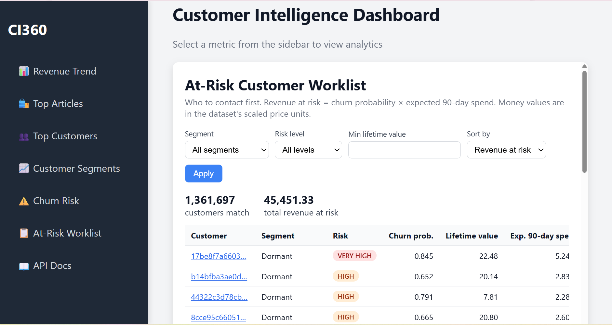
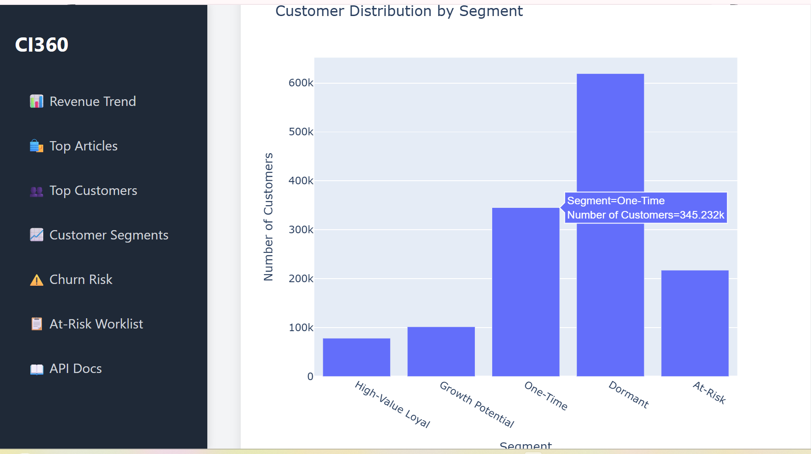
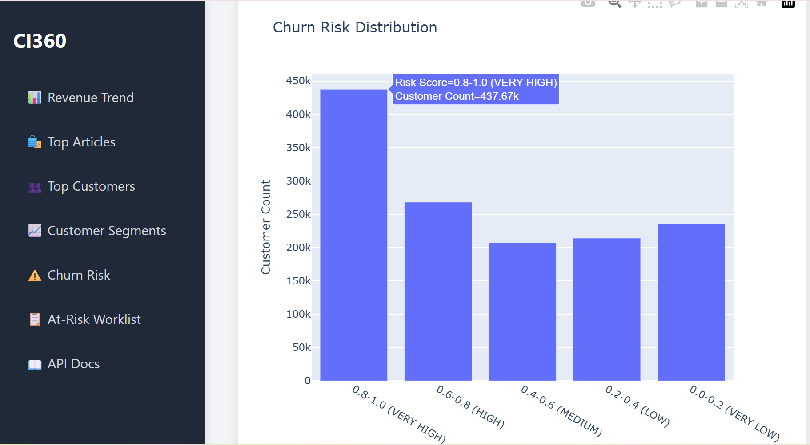
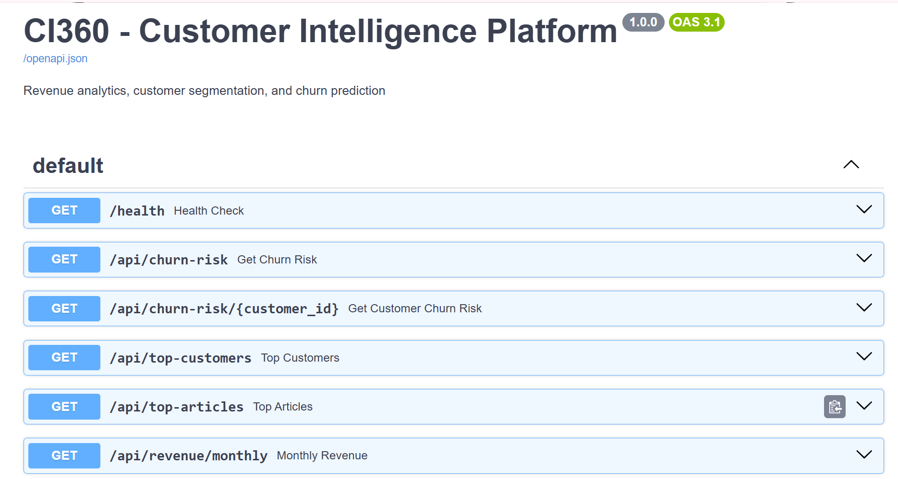
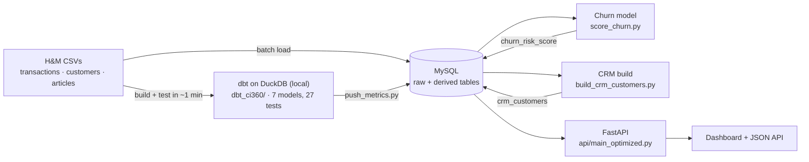
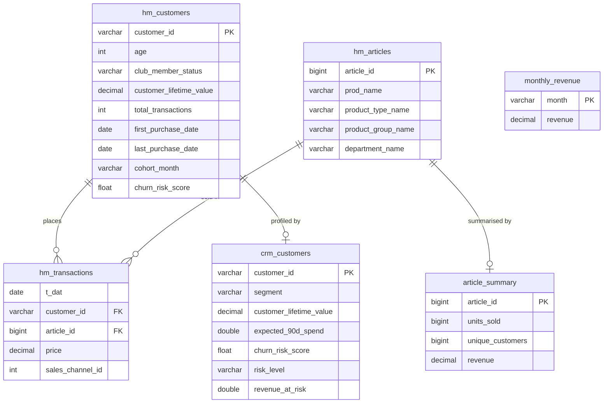

# CI360: Customer Intelligence 360

**A mini CRM that turns 31.8 million retail transactions into customer intelligence and revenue analytics.**

CI360 loads the H&M Personalized Fashion dataset into MySQL, works out who each customer is (value, recency, segment), predicts who is about to stop buying, and puts a price on that risk. A FastAPI backend serves it all as a JSON API and an interactive dashboard, including a worklist that tells a retention team **who to contact first**.



*The At-Risk Worklist inside the CI360 dashboard: customers ranked by revenue at risk, filterable by segment, risk level and lifetime value.*

---

## Contents

- [Key results](#key-results)
- [Dashboard tour](#dashboard-tour)
- [Architecture](#architecture)
- [The data](#the-data)
- [Database schema](#database-schema)
- [Customer segmentation](#customer-segmentation)
- [Churn prediction](#churn-prediction)
- [Revenue at risk and the worklist](#revenue-at-risk-and-the-worklist)
- [API reference](#api-reference)
- [Getting started](#getting-started)
- [Refreshing the data](#refreshing-the-data)
- [Project structure](#project-structure)
- [Limitations and next steps](#limitations-and-next-steps)

---

## Key results

Figures from the full dataset: 31,788,324 transactions, 20 Sep 2018 – 22 Sep 2020.

| | |
|---|---|
| **Customers who purchased** | 1,361,697 (of 1,371,980 registered) |
| **Products sold** | 104,547 distinct articles |
| **Total revenue** | 884,653 (dataset price units, see [note](#the-data)) |
| **Online share of items sold** | 70.4% |

**A small group drives the business.** The **High-Value Loyal** segment is **5.7% of customers but 31.2% of revenue**, and has the lowest churn risk (average 0.07).

**Most of the base is drifting away.** **45.5%** of purchasing customers are **Dormant** (no purchase in 180+ days), and **51.8%** have a churn probability of **0.6 or higher** for the next 90 days.

**Revenue at risk is concentrated where value is low.** Total expected 90-day revenue at risk is **45,451**, and the Dormant segment alone carries **37.6%** of it (17,105).

**Seasonality is strong.** Revenue peaks every June (48,649 in June 2019, 43,056 in June 2020), dips over winter, and fell to its lowest full-month level in Jan–Feb 2020 before recovering in spring.

---

## Dashboard tour

Start the API and open `http://127.0.0.1:8000/dashboard`. Every chart is rendered with Plotly from the pre-aggregated tables, so pages load instantly even on 31.8M rows.

### Revenue trend


Two June peaks (48.6K in 2019, 43.1K in 2020), a winter low in Jan–Feb 2020, and a spring recovery. The first and last points are partial months.

### Customer segments



Dormant customers are the largest group (619K), while High-Value Loyal is the smallest (78K) but brings in 31% of revenue.

### Churn risk



Over half of purchasing customers score 0.6 or higher: likely to make no purchase in the next 90 days.

### At-Risk Worklist

The page at the top of this README. It answers the CRM question "who should we contact first?" by ranking customers on revenue at risk (see [below](#revenue-at-risk-and-the-worklist)).

### API documentation



FastAPI generates interactive documentation at `/docs`, where every endpoint can be tried in the browser.

---

## Architecture



**Why MySQL, DuckDB and dbt?** MySQL holds the data the API serves. Heavy aggregation (per-customer lifetime value, segments, monthly revenue, article summaries) runs in **DuckDB** straight from the CSVs on a laptop in about a minute; the same work as correlated `UPDATE`s on a remote MySQL server is far slower. **dbt** organises that SQL into staging models (the data cleaning) and marts (metrics and segments), and runs 27 tests on every build: unique keys, no orphan transactions across all 31.8M rows, revenue reconciliation and a row count that must match the source. `push_metrics.py` copies the small results to MySQL only if the last build passed every test.

---

## The data

Source: [H&M Personalized Fashion Recommendations](https://www.kaggle.com/competitions/h-and-m-personalized-fashion-recommendations/data) (Kaggle). The CSVs are not in this repo (3.5 GB in total); download them into the project root.

| File | Rows | What it holds |
|---|---|---|
| `transactions.csv` | 31,788,324 | One row per item bought: date, customer, article, price, sales channel (1 = store, 2 = online) |
| `customers.csv` | 1,371,980 | Age, club membership status, fashion-news preferences, postal code (hashed) |
| `articles.csv` | 105,542 | Product name, type, group, department, colour, garment group, description |

> **Prices are scaled.** H&M published prices divided by an undisclosed constant, so every money figure in CI360 (revenue, lifetime value, revenue at risk) is in these dataset units, not currency. Comparisons and shares are still exact.

---

## Database schema



| Table | Rows | Built by | Purpose |
|---|---|---|---|
| `hm_transactions` | 31.8M | `Data.ipynb` / `resume_transactions_load.py` | Every purchase. Indexed on `customer_id` and `article_id`. |
| `hm_customers` | 1.37M | `Data.ipynb`, enriched by `push_metrics.py` (from dbt) and `score_churn.py` | Customer master plus lifetime metrics, segment and churn score. |
| `hm_articles` | 105K | `Data.ipynb` | Product catalogue. |
| `article_summary` | 105K | dbt → `push_metrics.py` | Units sold, unique customers and revenue per article. |
| `monthly_revenue` | 25 | dbt → `push_metrics.py` | Revenue per month. |
| `crm_customers` | 1.36M | `build_crm_customers.py` | One indexed row per purchasing customer: everything the CRM screens need. |

Foreign keys (`setup_relationships.sql`): transactions → customers and → articles use `ON DELETE RESTRICT`, so deleting a customer or product can never silently erase sales history. `article_summary` → articles cascades, because it is derived data.

---

## Customer segmentation

Each purchasing customer gets one segment from their lifetime value and how long ago they last bought, measured from the last date in the data (2020-09-22). Rules are applied top to bottom; the first match wins.

| Segment | Rule | Customers | Share | Revenue | Share of revenue | Avg churn risk |
|---|---|---:|---:|---:|---:|---:|
| **High-Value Loyal** | CLV ≥ 1.50 and last purchase < 30 days ago | 78,134 | 5.7% | 275,974 | 31.2% | 0.07 |
| **Growth Potential** | CLV ≥ 0.75 and last purchase 31–90 days ago | 101,620 | 7.5% | 187,771 | 21.2% | 0.18 |
| **One-Time** | Everyone not matched by another rule | 345,232 | 25.4% | 154,549 | 17.5% | 0.37 |
| **Dormant** | Last purchase > 180 days ago | 619,389 | 45.5% | 151,774 | 17.2% | 0.80 |
| **At-Risk** | Last purchase 91–180 days ago | 217,322 | 16.0% | 114,564 | 13.0% | 0.56 |

The rules live in one place: the dbt model `dbt_ci360/models/marts/customer_segments.sql`, where tests check that every buyer gets exactly one valid segment.

---

## Churn prediction

**Definition.** A customer has churned if they make **no purchase in the 90 days after a cutoff date**. Features use only transactions on or before the cutoff, so the model never sees the future it is predicting.

**Features** (per customer, as of the cutoff): days since last purchase, tenure, items bought, distinct shopping days, total spend, items in the last 90 days, and share of items bought online.

**Model.** Random forest (200 trees, depth 12, balanced class weights), in `churn_pipeline.py`.

**Honest evaluation.** `evaluate_churn.py` trains on one period and tests on a later one it has never seen (out-of-time), and compares against a recency-only baseline:

```
T = last transaction date (2020-09-22), H = 90 days
train cutoff = T − 2H   →  labels from the following 90 days
test cutoff  = T − H    →  out-of-time test
score as of  = T        →  probability of no purchase in the next 90 days
```

Results (train cutoff 2020-03-26 on 1,189,917 customers; tested on 1,291,147 customers at cutoff 2020-06-24, churn rate 65.3%):

| Metric | Model | Recency-only baseline |
|---|---:|---:|
| **AUC-ROC** | **0.838** | 0.781 |
| Precision (churn) | 85.6% | |
| Recall (churn) | 76.5% | |
| Accuracy | 76.2% | 65.3% (always predict churn) |

Of the customers the model flags, 86% really do not come back in the next 90 days, and it catches three in four of those who leave. It beats ranking by recency alone by +0.057 AUC.

**What drives churn** (feature importance): number of distinct shopping days (31.7%), days since last purchase (19.3%), items bought (18.9%), total spend (13.1%), items in the last 90 days (11.5%), tenure (2.8%), online share (2.7%). How often someone comes back matters more than how recently.

**Scores in production.** `score_churn.py` retrains on the most recent labelled period and writes `hm_customers.churn_risk_score` for all 1,362,281 customers with purchases.

| Risk level | Score | Customers | Share |
|---|---|---:|---:|
| VERY HIGH | ≥ 0.8 | 437,256 | 32.1% |
| HIGH | 0.6 – 0.8 | 267,977 | 19.7% |
| MEDIUM | 0.4 – 0.6 | 207,079 | 15.2% |
| LOW | 0.2 – 0.4 | 214,152 | 15.7% |
| VERY LOW | < 0.2 | 235,233 | 17.3% |

---

## Revenue at risk and the worklist

A churn score alone says who might leave, not whether it matters. CI360 prices the risk:

```
expected_90d_spend = lifetime_value × 90 / max(tenure_days, 90)
revenue_at_risk    = churn_risk_score × expected_90d_spend
```

The **At-Risk Worklist** (`/viz/worklist`, or `/api/worklist` as JSON) ranks customers by revenue at risk, so a retention team starts with the customers whose loss would cost the most. It filters by segment, risk level and minimum lifetime value, sorts by revenue at risk, churn risk or lifetime value, and pages through results 50 at a time with live totals.

---

## API reference

Interactive docs (Swagger UI) at `http://127.0.0.1:8000/docs` once the server is running.

| Method | Endpoint | Returns |
|---|---|---|
| GET | `/` | API index with every endpoint |
| GET | `/health` | Database connectivity check |
| GET | `/customer/{customer_id}` | Full customer profile: segment, age, cohort, purchase dates, CLV, churn risk, revenue at risk |
| GET | `/api/customer-segments` | Customers, CLV, average recency, churn risk and revenue at risk per segment |
| GET | `/api/worklist` | Paged, filterable at-risk worklist with totals. Query: `segment`, `risk_level`, `min_ltv`, `sort`, `limit` (≤ 500), `offset` |
| GET | `/api/churn-risk?limit=1000` | Customers ranked by churn score (limit 1–10,000) |
| GET | `/api/churn-risk/{customer_id}` | One customer's churn score and risk level |
| GET | `/api/top-customers` | Top 10 customers by lifetime value |
| GET | `/api/top-articles` | Top 10 articles by revenue |
| GET | `/article/{article_id}` | Units sold, unique customers and revenue for one article |
| GET | `/api/revenue/monthly` | Revenue for each month |
| GET | `/api/revenue/summary` | Total and average monthly revenue, customers, units sold, articles |
| GET | `/dashboard` | Interactive dashboard |
| GET | `/viz/monthly-revenue`, `/viz/top-articles`, `/viz/top-customers`, `/viz/customer-segments`, `/viz/churn-risk`, `/viz/worklist` | Individual dashboard pages |

Example:

```bash
curl "http://127.0.0.1:8000/api/worklist?segment=High-Value%20Loyal&risk_level=HIGH&limit=5"
```

---

## Getting started

**Prerequisites:** Python 3.11+, Python 3.13 for dbt (dbt does not support 3.14 yet), a MySQL 8 database you can create tables in, and the three H&M CSVs in the project root.

```bash
git clone https://github.com/Takudzwa604/CI360.git
cd CI360
pip install -r requirements.txt
```

**1. Configure the database connection**

```bash
cp api/.env.example api/.env     # then fill in DB_HOST, DB_PORT, DB_USER, DB_PASSWORD, DB_NAME
```

`api/.env` is git-ignored. Every script and the API read it.

**2. Load the raw data.** Run the table-creation and load cells in `Data.ipynb` (articles, customers, transactions). Loading 31.8M transactions over a network takes a while; if it is interrupted, run `python resume_transactions_load.py` to continue exactly where it stopped. It verifies the boundary before inserting, so nothing is loaded twice.

**3. Build the analytics** (in this order):

```bash
cd dbt_ci360                        # first time: py -3.13 -m venv .venv && .venv\Scripts\pip install dbt-duckdb
.venv\Scripts\dbt build             # local: build + test metrics and segments from the CSVs (~1 min)
cd ..
python push_metrics.py              # copy results to MySQL (only if every dbt test passed)
mysql < setup_relationships.sql     # foreign keys (or run it in your SQL client)
python score_churn.py               # train the churn model and score every customer
python build_crm_customers.py       # build crm_customers: segments, risk, revenue at risk
```

Optional: `python evaluate_churn.py` prints the out-of-time evaluation shown in [Churn prediction](#churn-prediction).

**4. Start the API**

```bash
uvicorn api.main_optimized:app --reload
```

Then open `http://127.0.0.1:8000/dashboard` or `http://127.0.0.1:8000/docs`.

---

## Refreshing the data

When the source CSVs change, repeat step 3 in the same order. `push_metrics.py` refuses to run unless the last `dbt build` passed every test and MySQL holds exactly as many transactions as the dbt build, so the summaries always match what the API serves. `dbt docs generate && dbt docs serve` shows the lineage graph. Summary tables and `crm_customers` are built under temporary names and swapped in atomically, so the API never sees a half-built table.

---

## Project structure

```
CI360/
├── api/
│   ├── main_optimized.py          FastAPI app: JSON API, dashboard, worklist
│   └── .env.example               Template for DB credentials (copy to .env)
├── Data.ipynb                     Create tables and load the raw CSVs into MySQL
├── resume_transactions_load.py    Resume an interrupted transactions load safely
├── dbt_ci360/                     dbt project on DuckDB: cleaning, metrics, segments, tests
├── push_metrics.py                Push the tested dbt tables to MySQL
├── setup_relationships.sql        Foreign keys, with orphan checks; safe to re-run
├── churn_pipeline.py              Churn definition, features, labels, model
├── evaluate_churn.py              Out-of-time churn evaluation vs. baseline
├── score_churn.py                 Scores every customer, writes churn_risk_score
├── build_crm_customers.py         Builds crm_customers (segments, risk, revenue at risk)
├── db_config.py                   Shared MySQL connection (reads api/.env)
├── pictures/                      README images
└── requirements.txt
```

---

## Limitations and next steps

**Limitations**
- Money values are in H&M's scaled price units, not real currency.
- Segments and churn scores are a snapshot as of the last date in the data (2020-09-22); there is no live feed.
- The first and last months (Sep 2018, Sep 2020) are partial.

**Next steps**
- Add an RFM score and cohort-retention view.
- Track worklist outcomes (contacted, retained) to measure campaign impact.
- Schedule the refresh pipeline (dbt build → push → score → CRM) and deploy the API to the cloud.
