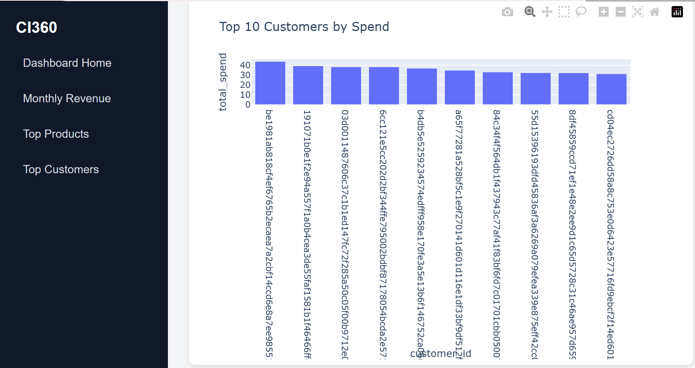
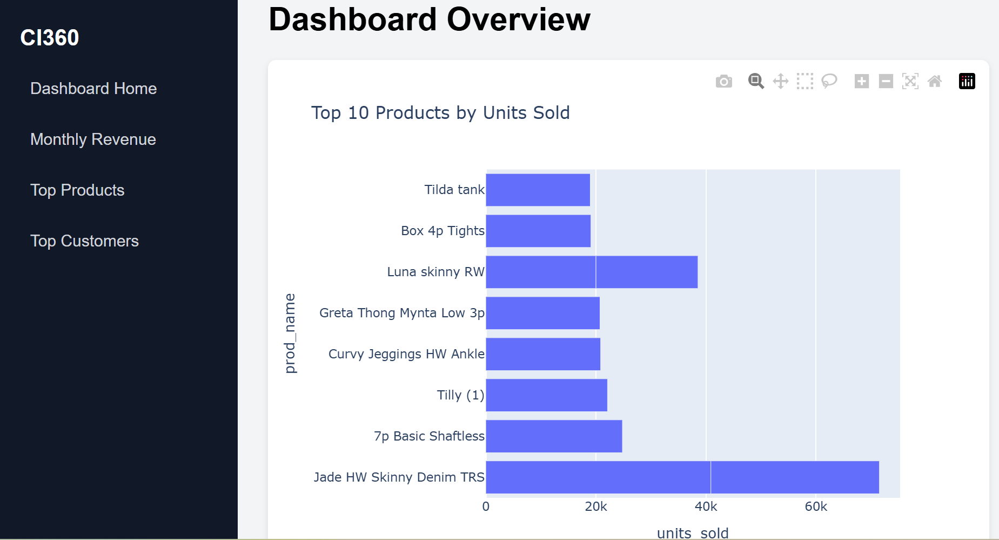
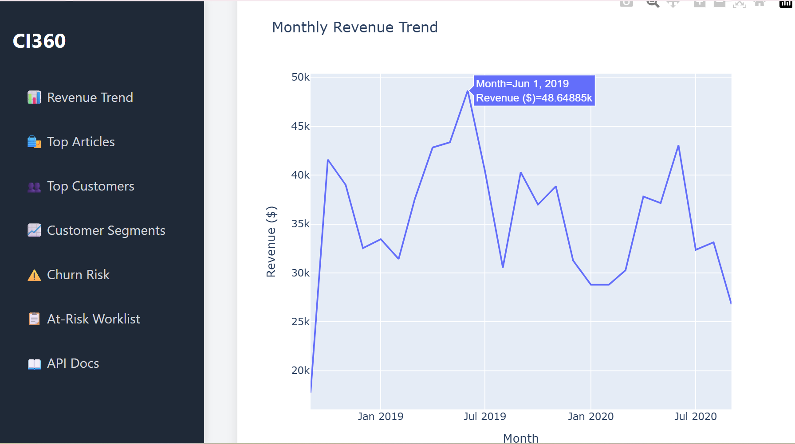

# CI360: Customer Intelligence API

* A Data Engineering + Analytics + ML System built on the H&M Dataset

---
## Project Structure

CI360/
│
├── api/
│   ├── main_optimized.py      (the FastAPI app)
│   ├── recommender.py         (offline recommender; not served by the API)
│   ├── .env                  (git-ignored - DB credentials; copy from .env.example)
│   ├── .env.example          (template listing the required DB_* variables)
│   │
│   ├── model/
│   │   └── model.pkl          
│   │
│   └── __pycache__/          
│
├── scripts/
│   └── train_model.py        (rebuilds api/model/model.pkl from hm_transactions)
│
├── customers.csv              (git-ignored - re-download the H&M dataset instead)
├── articles.csv                (git-ignored)
├── transactions.csv            (git-ignored)
│
├── db_config.py               (DB connection for scripts; reads api/.env)
├── resume_transactions_load.py (resumes an interrupted hm_transactions load)
├── duckdb_metrics.py          (computes summaries + customer metrics locally, pushes to MySQL)
├── churn_pipeline.py          (shared churn features, labels and model)
├── churn_model.py             (out-of-time churn model evaluation)
├── Populate_Churn_score.py    (writes hm_customers.churn_risk_score)
├── build_crm_customers.py     (builds crm_customers: worklist, profiles, segments)
├── setup_relationships.sql    (foreign keys; safe to re-run)
├── requirements.txt
├── Data.ipynb                 
├── README.md                  
├── .gitignore                 


This project implements a Customer Intelligence system that combines:

* Data Engineering (ETL pipeline)
* Data Warehousing (aggregated tables)
* Analytics (customer & product insights)
* Machine Learning (churn prediction)
* Business Intelligence (customer, product, revenue insights)
* API Layer (FastAPI)
* Interactive Dashboards (HTML + Plotly)

The system transforms raw transactional data into actionable intelligence through a unified backend.

---

## Database Schema

## Dataset Tables

| Table Name        | Description                              |
|-------------------|------------------------------------------|
| `hm_customers`    | Customer demographics and loyalty data   |
| `hm_articles`     | Product catalog                          |
| `hm_transactions` | All purchase events                      |


These represent raw transactional data from the H&M dataset.

---

 ## Aggregated Tables

| Table Name         | Description                                      |
|--------------------|--------------------------------------------------|
| `crm_customers`    | One row per purchasing customer: segment, lifetime value, recency, churn risk, revenue at risk (built by `build_crm_customers.py`) |
| `article_summary`  | Product-level aggregates: units sold, unique customers, and total revenue |
| `monthly_revenue`  | Revenue aggregated by month (2018–2020)           |

Optimized for analytics and API performance:

---
These tables support fast queries and power API endpoints.

---

## ETL Pipeline

The ETL pipeline ensures data is clean, structured, and analytics-ready.

## 1. Extract

* Load CSV files from the H&M dataset

## 2. Transform

* Handle missing values
* Normalize data types
* Create aggregated warehouse tables

## 3. Load

* Insert data into MySQL using batch operations
* Build summary tables for analytics

---

## FastAPI Endpoints

## 1. Customer 360 Profile

```
GET /customer/{customer_id}
```

Returns:

* Demographics
* Loyalty status
* Purchase behavior

---

##  2. Article Summary

```
GET /article/{article_id}
```

Returns:

* Product insights
* Similar high-performing items

---

## 3. Churn Risk

```
GET /api/churn-risk?limit=1000          (limit: 1-10,000)
GET /api/churn-risk/{customer_id}
```

Returns:

* Customers ranked by churn risk score
* Per-customer score and risk level (`VERY HIGH` ... `VERY LOW`, or `NOT SCORED` for customers with no transactions)

---

## 4. Top Customers and Articles

```
GET /api/top-customers
GET /api/top-articles
```

Returns:

* Top 10 customers by total spend
* Top 10 articles by revenue, with units sold and unique customers

---

## 5. Revenue

```
GET /api/revenue/monthly
GET /api/revenue/summary
```

Returns:

* Revenue trends (2018–2020)
* Totals: revenue, months, average monthly revenue, unique purchasing customers, units sold, articles

---

## 6. Customer Segments

```
GET /api/customer-segments
```

Returns:

* Customer counts and revenue by segment

---

## 7. At-Risk Worklist (CRM)

```
GET /api/worklist?segment=High-Value%20Loyal&risk_level=HIGH&min_ltv=0.5&sort=revenue_at_risk&limit=50&offset=0
GET /viz/worklist                       (filterable, paged table in the dashboard)
```

Returns:

* Customers ranked by **revenue at risk** = churn probability × expected 90-day spend
  (expected 90-day spend = lifetime value × 90 / max(tenure days, 90))
* Filters: segment, risk level, minimum lifetime value; sort by revenue at risk, churn risk or lifetime value
* Totals for the filtered list: customer count and total revenue at risk

Backed by the `crm_customers` table (one indexed row per purchasing customer), built by `build_crm_customers.py`.
The customer profile, segment and top-customer endpoints read from it too.

---

## 8. Dashboards and Health

```
GET /dashboard
GET /viz/monthly-revenue | /viz/top-articles | /viz/top-customers | /viz/churn-risk | /viz/customer-segments | /viz/worklist
GET /health
```

---

## Churn Model

* Churn = **no purchase in the 90 days after a cutoff date**. Features use only transactions up to the cutoff
  (recency, tenure, items, visits, spend, recent items, online share), so there is no label leakage.
* `python churn_model.py` trains at (last date − 180 days) and evaluates out-of-time at (last date − 90 days),
  reporting precision, recall and AUC against a recency-only baseline.
* `python Populate_Churn_score.py` writes `hm_customers.churn_risk_score` = probability of no purchase in the next 90 days.

---

## Recommender Model (offline, not served by the API)

* Built using customer transaction history
* Hybrid approach, implemented in `api/recommender.py` / trained by `scripts/train_model.py`:

  * **Collaborative filtering** - implicit-feedback ALS (via the `implicit` library), trained on
    (customer, article) purchase counts from `hm_transactions`, for customers with at least a
    few purchases in the training data
  * **Popularity / favorite-category fallback** - used for customers who weren't in the training
    set (new customers, or too little history), so every customer still gets a result

## Key Features:

* Serialized using `pickle`
* Retrain by running `python scripts/train_model.py` (reads DB credentials from `api/.env`,
  same as the API itself - no hardcoded credentials)
* Supports:

  * Global recommendations
  * Personalized recommendations

---

## Initial Analysis Summary

##  Customer Insights

* High-frequency, low-value shoppers dominate
* Loyalty engagement varies significantly
* Recency patterns indicate churn risk signals

 
---

## Product Insights

* Dresses and denim are top-performing categories
* Strong overlap between:

  * Units sold
  * Unique customers
* Ideal for:

  * Cross-selling
  * Promotions

---

## Revenue Trends

* Peak revenue in mid-2019
* Clear seasonal patterns
* Decline in early 2020 (COVID impact)

---

All charts are rendered using Plotly and embedded in HTML.

---
## How to Run the API

## 1. Install dependencies

```bash
pip install -r requirements.txt
```

## 2. Start MySQL and configure credentials

Copy the template and fill in your MySQL connection details:

```bash
cp api/.env.example api/.env
```

`api/.env` is git-ignored, so your credentials stay local.

---

## 3. Score churn risk

```bash
python churn_model.py            # evaluate the model
python Populate_Churn_score.py   # write scores used by /api/churn-risk
python build_crm_customers.py    # build crm_customers (worklist, profiles, segments); rerun after rescoring
```

Optional, offline only: train the hybrid recommender

```bash
python scripts/train_model.py
```

Run this once to replace the existing popularity-only `api/model/model.pkl` with the new
hybrid (ALS + fallback) model, and again any time `hm_transactions` changes meaningfully.

---

## 4. Start FastAPI Server

```bash
uvicorn api.main_optimized:app --reload
```

---

## 5. Access API Documentation

```
http://127.0.0.1:8000/docs
http://127.0.0.1:8000/dashboard

```

---

## Future Enhancements

* Add RFM (Recency, Frequency, Monetary) scoring endpoint
* Implement churn prediction model
* Add real-time churn alerts
* Build dashboard (Power BI / Streamlit)
* Deploy to cloud (AWS / Azure)

---


